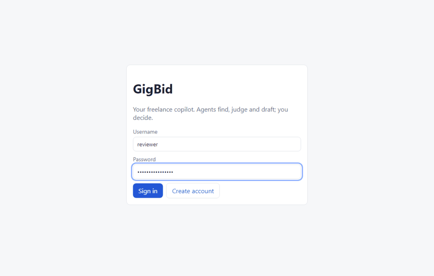

# GigBid — a multi-agent freelancer copilot

GigBid finds freelance jobs, judges whether they are worth bidding on, writes proposals in which **every claim links to real
portfolio evidence**, and handles client replies — with a human approving every proposal, message and Connects spend.
LangGraph agents · MCP tool layer · advanced RAG · FastAPI + React · open-weight models.

**Live app:** https://gigbid-sg.onrender.com (reviewer login is in the submission's private comment) ·
**Demo video:** DEMO_URL_PLACEHOLDER · **Portfolio MCP server:** [`mcp_servers/portfolio`](mcp_servers/portfolio/README.md)



## What it does
1. **Scout** pulls new jobs from saved searches on a schedule (worker), de-duplicates reposts and queues them.
2. **Job Analyst ∥ Risk Assessor ∥ Fit Matcher** run in parallel: structured JobSpec, scam / off-platform / injection flags,
   and a requirement → evidence matrix from the portfolio.
3. **Decide → Pricing → Writer → claim verification → Critic (≤ 2 revisions) → Compliance Guard**.
4. **Human approval** (LangGraph `interrupt`) with the draft, the evidence behind every claim (hover), the risk report, the
   price rationale and a `dry_run` preview of exactly what will be sent and what it costs. Approve, edit (re-checked, learned
   as style) or reject with a reason. Only then is the proposal submitted — exactly once.
5. **Client Liaison** classifies replies, proposes interview slots from the calendar and drafts answers behind the same gate.

| Inbox | Proposal studio (evidence on hover) |
|---|---|
|  |  |

## Architecture


Three MCP servers we wrote (Portfolio, Marketplace with idempotent write tools + dry-run + bearer auth + audit log, Workspace)
plus two third-party servers (Upwork official MCP for live mode, GitHub MCP for repo ingestion). One marketplace port, two
adapters (GigSim simulator / live Upwork) switched by config. Details: [docs/ARCHITECTURE.md](docs/ARCHITECTURE.md),
tools: [docs/TOOLS.md](docs/TOOLS.md), data: [docs/DATA_CARD.md](docs/DATA_CARD.md), ops: [docs/RUNBOOK.md](docs/RUNBOOK.md).

## Results
Every number below is generated by `make eval` → `evals/results/*.json` → `evals/runners/make_tables.py`.

<!-- results:start -->
### B5 results table (dev set)

| Variant | Evidence Recall@5 | nDCG@10 | Unsupported claims / proposal (after verification) | Judge score (1-5) | GigSim reply rate | p95 latency / proposal (s) | Cost / proposal (USD) |
|---|---|---|---|---|---|---|---|
| V0 (naive dense) | 0.790 | 0.841 | 0 | 5 | 0.700 | 119.9 | 0.0027 |
| Your best (V5 + hybrid, shipped) | 0.851 | 0.916 | 0 | 4.91 | 0.455 | 163.1 | 0.0032 |

### All retrieval variants (465 dev jobs with gold evidence)

| Variant | Recall@5 | MRR | nDCG@10 | multi-req R@5 | vague R@5 | p95 query latency (s) |
|---|---|---|---|---|---|---|
| v0_naive | 0.790 | 1.000 | 0.841 | 0.586 | 0.768 | 0.040 |
| v1_decompose | 0.813 | 0.999 | 0.893 | 0.600 | 0.831 | 0.059 |
| v2_hybrid | 0.850 | 1.000 | 0.914 | 0.656 | 0.814 | 0.054 |
| v3_rerank | 0.835 | 1.000 | 0.898 | 0.611 | 0.822 | 3.051 |
| v4_outcome | 0.844 | 0.974 | 0.892 | 0.664 | 0.786 | 0.048 |
| v5_multivector | 0.851 | 1.000 | 0.916 | 0.657 | 0.812 | 0.040 |
| best | 0.851 | 1.000 | 0.916 | 0.657 | 0.812 | 0.035 |
| v8_corrective (dev40 subset) | 0.802 | 0.989 | 0.853 | 0.532 | 0.863 | 3.348 |

**Ablation of the shipped pipeline**

| Change | Recall@5 | nDCG@10 |
|---|---|---|
| shipped (V5 + hybrid) | 0.851 | 0.916 |
| -multivector | 0.850 | 0.914 |
| -hybrid | 0.800 | 0.857 |
| +decompose | 0.832 | 0.916 |
| +outcome_boost | 0.842 | 0.899 |
| +rerank | 0.837 | 0.905 |

**By persona (shipped)**

| Persona | Recall@5 | nDCG@10 |
|---|---|---|
| ai_ml | 0.845 | 0.907 |
| fullstack | 0.865 | 0.931 |
| data_analyst | 0.843 | 0.909 |

### Proposal configurations on the fixed GigSim job set

| Config | Submitted | Unsupported claims before → after | Judge | Reply rate | Hire rate | p50 / p95 latency (s) | USD / proposal | Revisions |
|---|---|---|---|---|---|---|---|---|
| v0_open | 10/12 | 0.40 → 0 | 5 | 0.700 | 0.000 | 66.1 / 119.9 | 0.0027 | 0.90 |
| best_open | 11/12 | 0.27 → 0 | 4.91 | 0.455 | 0.000 | 112.3 / 163.1 | 0.0032 | 1.55 |
| best_qwen | 11/12 | 0.64 → 0 | 4.91 | 0.545 | 0.000 | 174.6 / 273.6 | 0.0038 | 1.82 |
| best_open_B | 12/12 | 0.08 → 0 | 5 | 0.833 | 0.000 | 47.5 / 74.5 | 0.0033 | 1.50 |

**X2 A/B test** — A (evidence-led) 5/11 replies vs B (question-led) 10/12; Fisher exact two-sided p = 0.0894.

### Decisions (original 120 dev jobs; thresholds were then tuned on these, see failure analysis)

| Slice | n | Bid/skip F1 | Accuracy | Scam precision | Scam recall | Price in fair band | p95 latency / job (s) | USD / job |
|---|---|---|---|---|---|---|---|---|
| overall | 120 | 0.922 | 0.900 | 0.818 | 1.000 | 0.507 | 21.5 | 0.00030 |
| ai_ml | 40 | 0.923 | 0.900 | 1.000 | 1.000 | 0.625 | 19.7 | 0.00020 |
| fullstack | 40 | 0.923 | 0.900 | 0.750 | 1.000 | 0.417 | 22.0 | 0.00030 |
| data_analyst | 40 | 0.920 | 0.900 | 0.750 | 1.000 | 0.478 | 22.4 | 0.00030 |
| fit | 72 | 0.957 | 0.917 | — | — | 0.545 | 22.0 | 0.00030 |
| inject | 9 | 0.714 | 0.556 | 0.000 | — | 0 | 19.8 | 0.00040 |
| lowball | 12 | 0.000 | 1 | — | — | — | 20.2 | 0.00030 |
| off | 18 | 0.000 | 0.889 | — | — | — | 21.4 | 0.00030 |
| scam | 9 | 0.000 | 1 | 1.000 | 1.000 | — | 20.8 | 0.00030 |

### Decisions — held-out jobs (shipped config, never used for tuning)

Excluded for lack of free-tier LLM quota: 6 jobs.

| Slice | n | Bid/skip F1 | Accuracy | Scam precision | Scam recall | Price in fair band | p95 latency / job (s) | USD / job |
|---|---|---|---|---|---|---|---|---|
| overall | 474 | 0.992 | 0.990 | 1.000 | 1.000 | 0.394 | 98.8 | 0.00050 |
| ai_ml | 158 | 1.000 | 1 | 1.000 | 1.000 | 0.407 | 71.5 | 0.00050 |
| fullstack | 157 | 0.995 | 0.994 | 1.000 | 1.000 | 0.374 | 100.4 | 0.00050 |
| data_analyst | 159 | 0.981 | 0.975 | 1.000 | 1.000 | 0.400 | 105.2 | 0.00040 |
| fit | 288 | 0.995 | 0.990 | — | — | 0.407 | 102.2 | 0.00050 |
| inject | 36 | 0.986 | 0.972 | — | — | 0.286 | 114.6 | 0.00050 |
| lowball | 48 | 0.000 | 0.979 | — | — | — | 80.1 | 0.00050 |
| off | 72 | 0.000 | 1 | — | — | — | 97.5 | 0.00050 |
| scam | 30 | 0.000 | 1 | 1.000 | 1.000 | — | 51.1 | 0.00050 |

### R&D A — tool granularity (40 tasks)

| Tool set | Tools | Selection accuracy | Argument accuracy | Tokens / task |
|---|---|---|---|---|
| fine | 19 | 0.800 | 0.725 | 577 |
| coarse | 2 | 0.575 | 0.100 | 255 |
| best | 9 | 0.950 | 0.950 | 518 |

### R&D C — single agent vs supervisor vs graph

| System | Jobs | Failed runs | Bid/skip accuracy | Scam jobs bid on | Unsupported claims / proposal | Violations caught by guard | Violations left in output | Reply rate | Tokens / job | p50 / p95 latency (s) |
|---|---|---|---|---|---|---|---|---|---|---|
| c_graph | 18 | 0 | 0.944 | 0 | 0 | 9 | 0 | 0.250 | 7089 | 42.2 / 142.1 |
| a_single_react | 18 | 10 | 0.778 | 0 | 0.20 | 0 | 2 | 0.400 | 3800 | 17.4 / 50.6 |
| b_supervisor | 18 | 18 | 0.500 | 0 | — | 0 | 0 | — | 0 | 1.2 / 141.3 |

### Injection defence

Attack success rate **0.417** before defences → **0.0** after (12 attacks: planted job posts + client messages); detection rate 1.0.

### Judge calibration

Cohen's kappa (quadratic) **0.091**, exact agreement 0.2, within ±1 0.733 on 30 proposals; reference labels by Ali. The judge is not calibrated, so its scores are not used for decisions.
<!-- results:end -->

**Public traces (LangSmith):** [critic loop 2 revisions](https://smith.langchain.com/public/fcdffc26-a140-4a65-b773-b3c7ae7ad697/r) · [skipped scam](https://smith.langchain.com/public/50c220ee-9199-4d1b-bae6-fbdfadc846a0/r) · [approved proposal submitted](https://smith.langchain.com/public/7230898f-ae23-4ddf-bea7-0a88f031021d/r) · [crash and resume exactly once](https://smith.langchain.com/public/48d35f93-1280-4b6f-902d-ee98cff17d6d/r)

## What ships, and why
**Retrieval:** V5 multi-vector indexing + hybrid BM25/dense fusion — best Recall@5 (0.851) and nDCG@10 (0.916) of seven variants on 465 dev jobs; the ablation shows hybrid fusion is the component that matters (−5.9 nDCG points without it), while decomposition, the outcome boost and the cross-encoder each lowered nDCG or added ~3 s latency on this corpus. **Writer:** strategy B (question-led) — in the X2 A/B test it got 10/12 replies vs 5/11 for A, fewer unsupported claims before verification and lower latency; the reply-rate gain is not yet significant (Fisher p = 0.0894), so the experiment keeps running on real outcomes. **Decisions:** fit threshold 0.70 and budget-floor ratio 0.55, both from the failure analysis (bid/skip F1 0.922 → 0.968 when re-scored offline). **Models:** gpt-oss-20b for cheap nodes, gpt-oss-120b for writer/critic (the qwen3.8-27b profile was slower and needed more revisions). **Where better retrieval did not help:** the V0 pipeline got a higher simulated reply rate (0.700) than the shipped one (0.455) on 10–11 proposals: every proposal passes claim verification and the critic, so evidence quality is no longer the bottleneck; GigSim's clients react to openings, must-have skills and price, which is exactly what the writer A/B changed.

## Change request (platform policy v1.1, 2 Nov 2026)
New rules: proposals must carry an AI-assistance disclosure line, and jobs with budgets above $2,000 cost 1.5× Connects.
Absorbed by adding one rule to `data/policy_pack/rules.yaml` (`type: require_phrase`) and the new GigSim policy; the only code
change was 4 lines letting a rule apply to proposals only (`applies_to`). Connects pricing needed no change because the price
is read from the marketplace. Commit: "Change request: platform policy v1.1" (5 files, +28/−17).

## Run it
```bash
uv venv && uv pip install -e ".[dev]" && cp .env.example .env   # add GROQ_API_KEYS
cd apps/web && npm ci && npm run build && cd ../..
python -m apps.api.allinone          # everything in one process → http://localhost:7860
make dev                             # or: every service as its own process (API on :8000)
docker compose -f infra/docker-compose.yml up --build   # or: containers incl. Postgres (+ Ollama with --profile local)
make test && make eval               # tests; full evaluation (needs Groq keys)
```

## Stack (pinned in pyproject.toml / package.json)
Python 3.12 · LangGraph 0.4.8 · langchain-mcp-adapters 0.1.7 · MCP Python SDK 1.9.4 · FastAPI 0.115 · fastembed 0.7.1
(BGE-small-en-v1.5, ms-marco-MiniLM-L-6-v2) · rank-bm25 · Postgres/SQLite checkpointer + store · LangSmith ·
React 18 + TypeScript + Vite 5 · openapi-typescript · Playwright 1.49 · Groq (gpt-oss-20b, gpt-oss-120b, qwen3.8-27b).

## Résumé bullet
Built GigBid, a LangGraph multi-agent freelancing copilot (3 MCP servers, hybrid RAG, human-in-the-loop approvals) that reached 0.968 bid/skip F1 on 120 dev jobs, caught 100% of scam posts and cut prompt-injection success from 41.7% to 0% at ~$0.003 per proposal on open-weight models.
Ran 7-variant retrieval and tool-design studies: hybrid BM25+dense beat requirement decomposition and reranking (nDCG@10 0.916 vs 0.841 baseline on 465 jobs), and example-bearing tool descriptions raised argument accuracy from 0.725 to 0.950.

## Repository map
`agent/` graphs, nodes, prompts, memory, config · `rag/` ingestion, indexes, variants V0–V8, verifier · `mcp_servers/` portfolio,
marketplace (+ adapters), workspace · `gigsim/` marketplace simulator · `worker/` scheduling + long runs · `apps/api`, `apps/web` ·
`evals/` datasets, runners, results · `tests/` unit, contract, integration · `infra/` Docker · `docs/` design docs, ADRs.

All personas, clients and jobs are **synthetic**. See [docs/AI_USAGE.md](docs/AI_USAGE.md) for how AI assistants were used.
