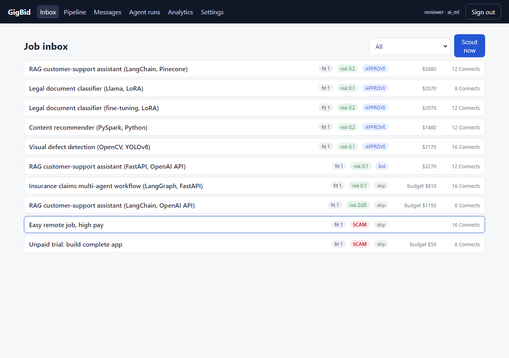
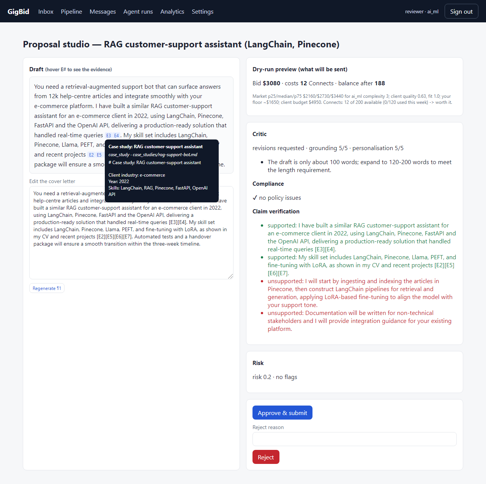
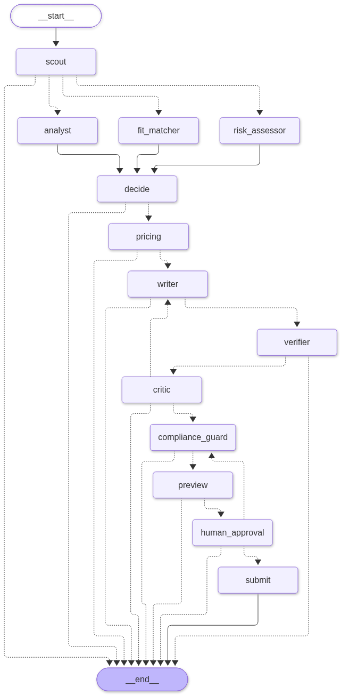

# GigBid — a multi-agent freelancer copilot

GigBid finds freelance jobs, judges whether they are worth bidding on, writes proposals in which **every claim links to real
portfolio evidence**, and handles client replies — with a human approving every proposal, message and Connects spend.
LangGraph agents · MCP tool layer · advanced RAG · FastAPI + React · open-weight models.

**Live app:** LIVE_URL_PLACEHOLDER (reviewer login is in the submission's private comment) ·
**Demo video:** DEMO_URL_PLACEHOLDER · **Portfolio MCP server:** [`mcp_servers/portfolio`](mcp_servers/portfolio/README.md)


## What it does
1. **Scout** pulls new jobs from saved searches on a schedule (worker), de-duplicates reposts and queues them.
2. **Job Analyst ∥ Risk Assessor ∥ Fit Matcher** run in parallel: structured JobSpec, scam / off-platform / injection flags,
   and a requirement → evidence matrix from the portfolio.
3. **Decide → Pricing → Writer → claim verification → Critic (≤ 2 revisions) → Compliance Guard**.
4. **Human approval** (LangGraph `interrupt`) with the draft, the evidence behind every claim (hover), the risk report, the
   price rationale and a `dry_run` preview of exactly what will be sent and what it costs. Approve, edit (re-checked, learned
   as style) or reject with a reason. Only then is the proposal submitted — exactly once.
5. **Client Liaison** classifies replies, proposes interview slots from the calendar and drafts answers behind the same gate.

| Inbox | Proposal studio (evidence on hover) |
|---|---|
|  |  |

## Architecture


Three MCP servers we wrote (Portfolio, Marketplace with idempotent write tools + dry-run + bearer auth + audit log, Workspace)
plus two third-party servers (Upwork official MCP for live mode, GitHub MCP for repo ingestion). One marketplace port, two
adapters (GigSim simulator / live Upwork) switched by config. Details: [docs/ARCHITECTURE.md](docs/ARCHITECTURE.md),
tools: [docs/TOOLS.md](docs/TOOLS.md), data: [docs/DATA_CARD.md](docs/DATA_CARD.md), ops: [docs/RUNBOOK.md](docs/RUNBOOK.md).

## Results
Every number below is generated by `make eval` → `evals/results/*.json` → `evals/runners/make_tables.py`.

<!-- results:start -->
RESULTS_PLACEHOLDER
<!-- results:end -->

**Public traces (LangSmith):** TRACES_PLACEHOLDER

## What ships, and why
WHAT_SHIPS_PLACEHOLDER

## Change request (platform policy v1.1, 2 Nov 2026)
New rules: proposals must carry an AI-assistance disclosure line, and jobs with budgets above $2,000 cost 1.5× Connects.
Absorbed by adding one rule to `data/policy_pack/rules.yaml` (`type: require_phrase`) and the new GigSim policy; the only code
change was 4 lines letting a rule apply to proposals only (`applies_to`). Connects pricing needed no change because the price
is read from the marketplace. Commit: "Change request: platform policy v1.1" (5 files, +28/−17).

## Run it
```bash
uv venv && uv pip install -e ".[dev]" && cp .env.example .env   # add GROQ_API_KEYS
cd apps/web && npm ci && npm run build && cd ../..
python -m apps.api.allinone          # everything in one process → http://localhost:7860
make dev                             # or: every service as its own process (API on :8000)
docker compose -f infra/docker-compose.yml up --build   # or: containers incl. Postgres (+ Ollama with --profile local)
make test && make eval               # tests; full evaluation (needs Groq keys)
```

## Stack (pinned in pyproject.toml / package.json)
Python 3.12 · LangGraph 0.4.8 · langchain-mcp-adapters 0.1.7 · MCP Python SDK 1.9.4 · FastAPI 0.115 · fastembed 0.7.1
(BGE-small-en-v1.5, ms-marco-MiniLM-L-6-v2) · rank-bm25 · Postgres/SQLite checkpointer + store · LangSmith ·
React 18 + TypeScript + Vite 5 · openapi-typescript · Playwright 1.49 · Groq (gpt-oss-20b, gpt-oss-120b, qwen3.8-27b).

## Résumé bullet
RESUME_PLACEHOLDER

## Repository map
`agent/` graphs, nodes, prompts, memory, config · `rag/` ingestion, indexes, variants V0–V8, verifier · `mcp_servers/` portfolio,
marketplace (+ adapters), workspace · `gigsim/` marketplace simulator · `worker/` scheduling + long runs · `apps/api`, `apps/web` ·
`evals/` datasets, runners, results · `tests/` unit, contract, integration · `infra/` Docker · `docs/` design docs, ADRs.

All personas, clients and jobs are **synthetic**. See [docs/AI_USAGE.md](docs/AI_USAGE.md) for how AI assistants were used.
