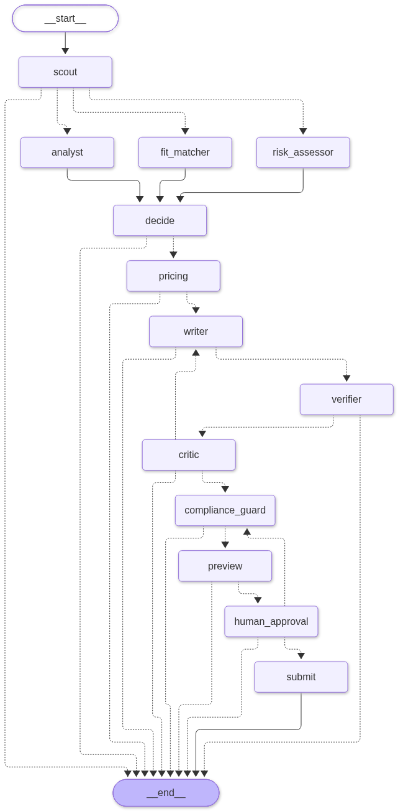
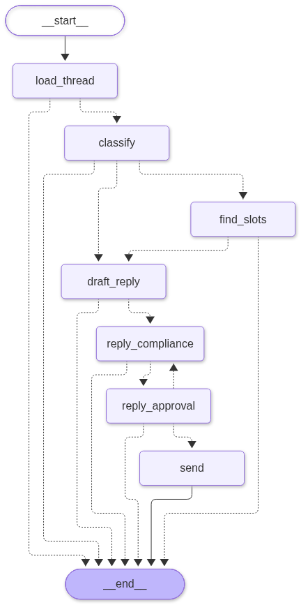

# Architecture

```
 Browser (React+TS) ──SSE/REST──► FastAPI (apps/api) ──► app DB (users, jobs, runs, run_events, tasks)
                                        │  enqueue                     ▲ events
                                        ▼                              │
                                   Worker (worker/) ── runs ──► LangGraph bid graph / conversation graph
                                                                   │  checkpointer + store (Postgres/SQLite)
                                        MCP (streamable HTTP, per-agent allowlists, agent/mcp_client.py)
                    ┌─────────────────────────┼──────────────────────────────┐
             Portfolio MCP               Marketplace MCP                  Workspace MCP
         (RAG over persona corpus)   (bearer auth, audit, idempotency)   (calendar, email drafts)
                                         │ marketplace port (R1)
                                ┌────────┴─────────┐
                           GigSim adapter     Upwork live adapter ──► Upwork official MCP (OAuth 2.1)
                                │
                             GigSim (REST simulator, LLM clients with hidden preferences)
```

## Bid graph (one thread per job) — rendered from code: `docs/images/bid_graph.png`


* **scout** loads the job via `get_job` and de-duplicates reposts by fingerprint in the store.
* **analyst ∥ risk_assessor ∥ fit_matcher** run in parallel (`Send` fan-out); reducers merge their writes (evidence de-dup,
  status severity, token/step counters).
* **decide** is a deterministic rule over `JobSpec`, `RiskReport`, `FitReport` with thresholds in `agent/config.yaml`.
* **pricing → writer → verifier → critic**; the critic can send the draft back **at most twice** (`budgets.max_revisions`).
* **compliance_guard** applies the policy pack (`data/policy_pack/rules.yaml`) and **blocks** when unsupported claims remain.
* **preview** calls `create_proposal_draft(dry_run)` so the approval shows exactly what will be sent and its Connects cost.
* **human_approval** is a LangGraph `interrupt()`: approve → `submit`; edit → diffed for style memory → back to compliance;
  reject → END with the reason. Nothing reaches GigSim/Upwork without it.

## Conversation graph (one thread per client conversation)


load_thread → classify intent (question / negotiation / interview_request / hire / scam_signal) → find_slots (workspace MCP,
for interviews) → draft_reply → reply_compliance → reply_approval (interrupt) → send (idempotent) + tentative calendar hold.

## Why each agent exists
| Agent | Why it is separate | Model |
|---|---|---|
| Scout | scheduling, de-dup and queueing are I/O work, not reasoning | none |
| Job Analyst | turns messy posts into a `JobSpec` every later step can trust | small (gpt-oss-20b) |
| Risk Assessor | scam/injection detection must not be influenced by "wanting" to bid; rules + small model | small |
| Fit Matcher | requirement → evidence matrix is retrieval, deterministic and auditable | none (Portfolio MCP) |
| Pricing Strategist | market stats + client spend + floor; separate so price rationale is explicit | none |
| Proposal Writer | the only creative step; gets the strongest model | strong (gpt-oss-120b) |
| Claim verifier | checks every claim against evidence *before* the critic (B3) | small |
| Critic | independent review of grounding, personalisation, length; bounded loop | strong |
| Compliance Guard | policy as config; last line of defence before a human sees the draft | rules |
| Client Liaison | conversations have different state, cadence and approvals than bids | strong |

## State, trace and memory are kept apart (C2)
* **State** (`agent/state.py`): typed fields for job, analyses, evidence, decision, price, draft, critiques, approval, outcome.
* **Execution trace**: `trace` list in state — every node's tool calls (masked args), tokens, cost, latency; plus LangSmith.
* **Long-term memory** (`agent/memory/`): LangGraph store namespaces `style/<user>` and `outcome/<user>`, written **only** via
  `promotion_rules.py` (style: same edit pattern in ≥ 2 approved edits; outcome: marketplace-confirmed statuses, category
  lesson promoted after ≥ 3 submissions). Users can see and delete memory in Settings.

## The marketplace port (R1)
`agent/marketplace_port.py` defines one interface; `GigSimAdapter` and `UpworkLiveAdapter` implement it; `marketplace.mode`
in config picks one. The Marketplace MCP server wraps the port, so the graph only ever sees MCP tools and cannot tell which
marketplace is behind it.

## Stores
| Store | Local | Deployed |
|---|---|---|
| Graph checkpointer + LangGraph store | SQLite (`AsyncSqliteSaver`, `AsyncSqliteStore`) | Postgres (`AsyncPostgresSaver`, `AsyncPostgresStore`) when `DATABASE_URL` is set |
| App DB (users, job index, runs, events, task queue, encrypted OAuth tokens) | SQLite | Postgres |
| Vector index | BGE-small embeddings in a numpy flat index + BM25, cached by content hash | same (baked into the image) |
| Audit log | `logs/audit.jsonl` (append-only, PII masked) | same |
